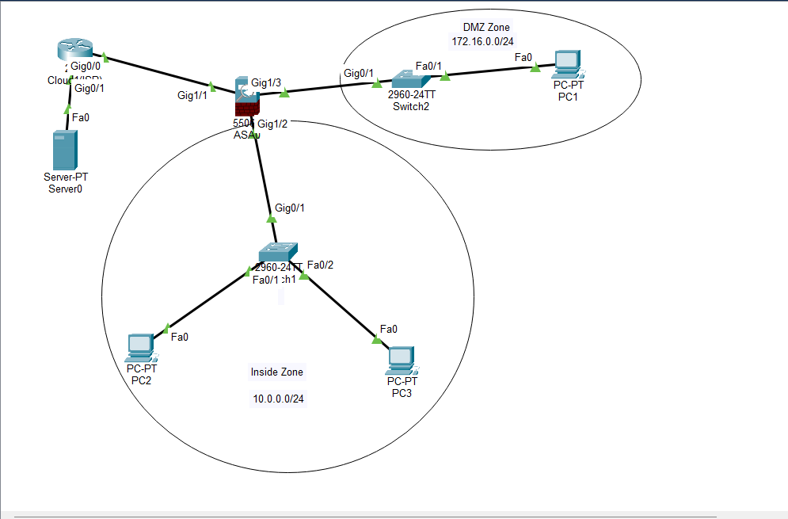
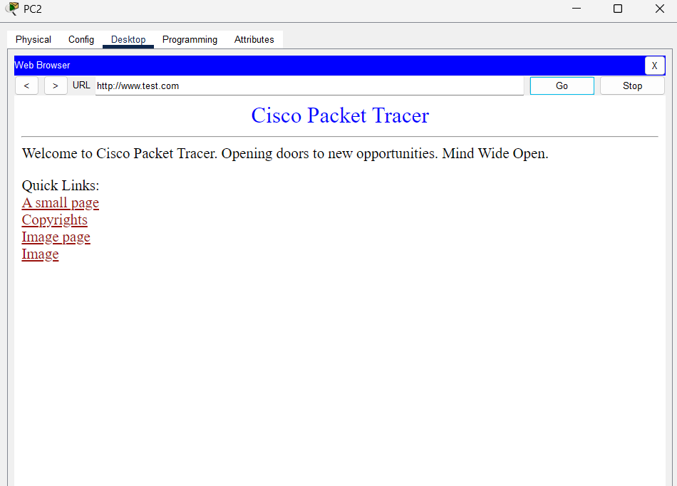

# Cisco ASA 3-Zone Firewall 

> Cisco ASA 5506-X firewall  with Inside / DMZ / Outside zones, DHCP, NAT and ACL policies — built in Cisco Packet Tracer

ตั้งค่า Cisco ASA 5506-X แบ่งเครือข่ายเป็น 3 โซน (Inside, DMZ, Outside) พร้อม DHCP, NAT และ Firewall Policy ด้วย Access Control List (ACL) จำลองบน **Cisco Packet Tracer** (ดัดแปลงจากใบงานต้นฉบับที่ใช้ GNS3 + ASAv)



---

## สารบัญ

- [จุดประสงค์](#จุดประสงค์)
- [โครงสร้างเครือข่าย](#โครงสร้างเครือข่าย)
- [อุปกรณ์ที่ใช้](#อุปกรณ์ที่ใช้)
- [ตาราง IP Address](#ตาราง-ip-address)
- [Firewall Policy](#firewall-policy)
- [คำสั่งที่ใช้](#คำสั่งที่ใช้)
- [การทดสอบ](#การทดสอบ)
- [ข้อแตกต่างจาก GNS3 และข้อจำกัดของ Packet Tracer](#ข้อแตกต่างจาก-gns3-และข้อจำกัดของ-packet-tracer)
- [ปัญหาที่พบและวิธีแก้](#ปัญหาที่พบและวิธีแก้)
- [โครงสร้างไฟล์ใน Repository](#โครงสร้างไฟล์ใน-repository)

---

## จุดประสงค์

1. ออกแบบเครือข่ายแบบแบ่งโซน (Network Segmentation) ด้วย Firewall
2. ตั้งค่า interface ของ ASA ได้แก่ `nameif`, `security-level` และ IP address
3. ตั้งค่า Default Route ให้ Firewall ออกอินเทอร์เน็ตได้
4. ใช้ ASA เป็น DHCP Server แจก IP ให้เครื่องในโซน Inside
5. ตั้งค่า Dynamic PAT (NAT) ให้ Inside และ DMZ ออกอินเทอร์เน็ตได้
6. เขียน Firewall Policy ด้วย ACL ตามหลัก **Least Privilege** คือเปิดเฉพาะสิ่งที่จำเป็น
7. ใช้ Stateful Inspection (`inspect icmp`, `inspect dns`) ให้ traffic ตอบกลับผ่านได้

| โซน | Network | Security Level | ความหมาย |
|---|---|---|---|
| **Inside** | 10.0.0.0/24 | 100 | เครือข่ายภายใน (เครื่องพนักงาน) น่าเชื่อถือที่สุด |
| **DMZ** | 172.16.0.0/24 | 50 | เซิร์ฟเวอร์ที่ให้คนภายนอกเข้าถึงได้ |
| **Outside** | 203.0.113.0/24 | 0 | อินเทอร์เน็ต ไม่น่าเชื่อถือ |

---

## โครงสร้างเครือข่าย

```
                         ┌──────────────────┐
                         │  Internet-Server │  8.8.8.8 (HTTP + DNS)
                         └────────┬─────────┘
                                  │ Fa0
                                  │ G0/1  8.8.8.1
                         ┌────────┴─────────┐
                         │  Cloud1 (ISP)    │  Router 2911
                         │                  │  DHCP pool 203.0.113.0/24
                         └────────┬─────────┘
                                  │ G0/0  203.0.113.1
                                  │
                                  │ G1/1  outside (DHCP → 203.0.113.11)
                         ┌────────┴─────────┐
                         │   ASA 5506-X     │
                         └───┬──────────┬───┘
            G1/2 inside      │          │      G1/3 dmz
            10.0.0.1/24      │          │      172.16.0.1/24
                      ┌──────┴───┐  ┌───┴──────┐
                      │ Switch1  │  │ Switch2  │
                      └─┬──────┬─┘  └────┬─────┘
                        │      │         │
                      PC2     PC3       PC1
                    (DHCP)  (DHCP)   172.16.0.10
                     ── Inside Zone ──   ─ DMZ Zone ─
```

### การเชื่อมต่อสาย (Copper Straight-Through ทั้งหมด)

| จาก | ไป |
|---|---|
| ASA GigabitEthernet1/1 | Router GigabitEthernet0/0 |
| Router GigabitEthernet0/1 | Server FastEthernet0 |
| ASA GigabitEthernet1/2 | Switch1 GigabitEthernet0/1 |
| Switch1 FastEthernet0/1 | PC2 FastEthernet0 |
| Switch1 FastEthernet0/2 | PC3 FastEthernet0 |
| ASA GigabitEthernet1/3 | Switch2 GigabitEthernet0/1 |
| Switch2 FastEthernet0/1 | PC1 FastEthernet0 |

---

## อุปกรณ์ที่ใช้

| อุปกรณ์ | รุ่นใน Packet Tracer | หน้าที่ |
|---|---|---|
| Firewall | ASA 5506-X (ASA 9.6(1)) | แบ่งโซน, NAT, DHCP, ACL |
| Cloud1 (ISP) | Router 2911 | จำลองผู้ให้บริการอินเทอร์เน็ต + แจก DHCP ให้ขา outside |
| Internet-Server | Server-PT | จำลองอินเทอร์เน็ต (HTTP + DNS) |
| Switch1, Switch2 | 2960-24TT | สวิตช์ของโซน Inside และ DMZ |
| PC1, PC2, PC3 | PC-PT | เครื่องลูกข่าย |

---

## ตาราง IP Address

| อุปกรณ์ | Interface | IP Address | Gateway | DNS |
|---|---|---|---|---|
| ASA | G1/1 (outside) | DHCP (203.0.113.11/24) | 203.0.113.1 | – |
| ASA | G1/2 (inside) | 10.0.0.1/24 | – | – |
| ASA | G1/3 (dmz) | 172.16.0.1/24 | – | – |
| Router (ISP) | G0/0 | 203.0.113.1/24 | – | – |
| Router (ISP) | G0/1 | 8.8.8.1/24 | – | – |
| Internet-Server | Fa0 | 8.8.8.8/24 | 8.8.8.1 | 8.8.8.8 |
| PC1 (DMZ) | Fa0 | 172.16.0.10/24 (Static) | 172.16.0.1 | 8.8.8.8 |
| PC2 (Inside) | Fa0 | DHCP (10.0.0.100) | 10.0.0.1 | 8.8.8.8 |
| PC3 (Inside) | Fa0 | DHCP (10.0.0.101) | 10.0.0.1 | 8.8.8.8 |

---

## Firewall Policy

| # | Policy | จาก → ไป | การตั้งค่า |
|---|---|---|---|
| 1 | อนุญาต DNS | Any → Any | `eq domain` ใน ACL ทั้ง 3 ชุด |
| 2 | อนุญาต ICMP เฉพาะ Inside | Inside → Internet | `permit icmp` อยู่ใน `INSIDE_IN` เท่านั้น |
| 3 | อนุญาต HTTP | Inside, DMZ → Internet | `eq www` ใน `INSIDE_IN` และ `DMZ_IN` |
| 4 | อนุญาต HTTP/HTTPS | Internet → DMZ เท่านั้น | `OUTSIDE_IN` ปลายทาง 172.16.0.0/24 พอร์ต 80, 443 |
| – | ห้าม Inside ↔ DMZ | Inside ↔ DMZ | `deny ip` ใน `INSIDE_IN` และ `DMZ_IN` |

---

## คำสั่งที่ใช้

### 1. Router – Cloud1 (ISP)

```
enable
configure terminal
hostname ISP
!
interface GigabitEthernet0/0
 ip address 203.0.113.1 255.255.255.0
 no shutdown
!
interface GigabitEthernet0/1
 ip address 8.8.8.1 255.255.255.0
 no shutdown
!
ip dhcp excluded-address 203.0.113.1 203.0.113.10
ip dhcp pool OUTSIDE
 network 203.0.113.0 255.255.255.0
 default-router 203.0.113.1
 dns-server 8.8.8.8
!
end
write memory
```

### 2. Internet-Server (ตั้งผ่าน GUI)

| เมนู | การตั้งค่า |
|---|---|
| Desktop → IP Configuration | Static, IP `8.8.8.8/24`, Gateway `8.8.8.1`, DNS `8.8.8.8` |
| Services → HTTP | HTTP **On**, HTTPS **On** |
| Services → DNS | DNS Service **On**, เพิ่ม A Record `www.test.com → 8.8.8.8` |

### 3. ASA 5506-X

#### 3.1 Interface

```
enable
configure terminal
!
interface GigabitEthernet1/1
 nameif outside
 security-level 0
 ip address dhcp
 no shutdown
!
interface GigabitEthernet1/2
 nameif inside
 security-level 100
 ip address 10.0.0.1 255.255.255.0
 no shutdown
!
interface GigabitEthernet1/3
 nameif dmz
 security-level 50
 ip address 172.16.0.1 255.255.255.0
 no shutdown
```

#### 3.2 Default Route

```
route outside 0.0.0.0 0.0.0.0 203.0.113.1
```

#### 3.3 NAT (Dynamic PAT)

```
object network INSIDE-NET
 subnet 10.0.0.0 255.255.255.0
 nat (inside,outside) dynamic interface
!
object network DMZ-NET
 subnet 172.16.0.0 255.255.255.0
 nat (dmz,outside) dynamic interface
```

#### 3.4 DHCP Server (Inside)

```
dhcpd address 10.0.0.100-10.0.0.200 inside
dhcpd dns 8.8.8.8
dhcpd enable inside
```

#### 3.5 Access Control List

```
! ---------- Inside ----------
access-list INSIDE_IN extended permit udp any any eq domain
access-list INSIDE_IN extended permit udp any any eq bootps
access-list INSIDE_IN extended deny ip 10.0.0.0 255.255.255.0 172.16.0.0 255.255.255.0
access-list INSIDE_IN extended permit icmp 10.0.0.0 255.255.255.0 any
access-list INSIDE_IN extended permit tcp 10.0.0.0 255.255.255.0 any eq www
access-group INSIDE_IN in interface inside
!
! ---------- DMZ ----------
access-list DMZ_IN extended permit udp any any eq domain
access-list DMZ_IN extended deny ip 172.16.0.0 255.255.255.0 10.0.0.0 255.255.255.0
access-list DMZ_IN extended permit tcp 172.16.0.0 255.255.255.0 any eq www
access-group DMZ_IN in interface dmz
!
! ---------- Outside ----------
access-list OUTSIDE_IN extended permit udp any any eq domain
access-list OUTSIDE_IN extended permit tcp any 172.16.0.0 255.255.255.0 eq www
access-list OUTSIDE_IN extended permit tcp any 172.16.0.0 255.255.255.0 eq 443
access-list OUTSIDE_IN extended permit icmp any any echo-reply
access-list OUTSIDE_IN extended permit tcp any eq www any
access-list OUTSIDE_IN extended permit udp any eq domain any
access-group OUTSIDE_IN in interface outside
```

#### 3.6 Stateful Inspection

```
class-map inspection_default
 match default-inspection-traffic
!
policy-map global_policy
 class inspection_default
  inspect icmp
!
service-policy global_policy global
!
end
write memory
```

### 4. PC

| เครื่อง | การตั้งค่า (Desktop → IP Configuration) |
|---|---|
| PC1 | Static: `172.16.0.10 / 255.255.255.0`, Gateway `172.16.0.1`, DNS `8.8.8.8` |
| PC2 | DHCP |
| PC3 | DHCP |

### 5. คำสั่งตรวจสอบ (ASA)

```
show interface ip brief
show route
show nat
show running-config
```

> ใน Packet Tracer คำสั่ง `show dhcpd binding` ขึ้น `% Incomplete command` จึงใช้ผล `ipconfig /all` ของ PC2/PC3 ยืนยันว่า DHCP ทำงานแทน

---

## การทดสอบ

| ทดสอบ | ผลที่คาดหวัง | ผลจริง |
|---|---|---|
| PC2, PC3 ขอ IP จาก DHCP | ได้ 10.0.0.100–200 | ✅ 10.0.0.100, 10.0.0.101 |
| PC2, PC3 `ping 8.8.8.8` | สำเร็จ | ✅ |
| PC2, PC3 เปิด `http://www.test.com` | เปิดได้ | ✅ |
| PC1 เปิด `http://www.test.com` | เปิดได้ | ✅ |
| PC1 `ping 8.8.8.8` | **ไม่สำเร็จ** (ICMP อนุญาตเฉพาะ Inside) | ✅ ถูกบล็อก |
| PC1 ↔ PC2/PC3 | **ไม่สำเร็จ** (DMZ ↔ Inside ถูกบล็อก) | ✅ ถูกบล็อก |



---

## ข้อแตกต่างจาก GNS3 และข้อจำกัดของ Packet Tracer

| ใบงานต้นฉบับ (GNS3) | Packet Tracer |
|---|---|
| Cisco ASAv | ASA 5506-X |
| Gi0/0, Gi0/1, Gi0/2 | G1/1, G1/2, G1/3 |
| Cloud1 (อินเทอร์เน็ตจริง) | Router 2911 + Server จำลองอินเทอร์เน็ต |
| VPCS (`show ip`) | PC-PT (`ipconfig /all`) |
| Cisco ASDM | **ไม่รองรับ** |

คำสั่งที่ Packet Tracer ไม่รองรับ (ขึ้น `This version of Cisco Packet Tracer does not support this option`):

```
http server enable
http 0.0.0.0 0.0.0.0 outside
aaa authentication http console LOCAL
```

ใน ASA จริงจะใช้คำสั่งเหล่านี้เปิด ASDM และยืนยันตัวตนผ่าน local database

---

## ปัญหาที่พบและวิธีแก้

| ปัญหา | สาเหตุ | วิธีแก้ |
|---|---|---|
| PC2/PC3 ได้ IP `169.254.x.x` (DHCP fail) | ใน PT ACL `INSIDE_IN` บล็อก DHCP request (UDP 67) | เพิ่ม `permit udp any any eq bootps` |
| `eq https` ใช้ไม่ได้ | PT ไม่รู้จักชื่อพอร์ต `https` | ใช้เลขพอร์ต `eq 443` |
| Router ping ขา outside ของ ASA ไม่ได้ / ping ตอบกลับไม่เข้ามา | ACL `OUTSIDE_IN` บล็อกแพ็กเก็ตตอบกลับ และ inspect ยังไม่ทำงาน | เปิด `service-policy global_policy global` และเพิ่ม `permit icmp any any echo-reply` |
| เว็บ/DNS ตอบกลับไม่ได้ | PT ไม่ทำ stateful ให้ครบเหมือน ASA จริง | เพิ่ม `permit tcp any eq www any` และ `permit udp any eq domain any` ใน `OUTSIDE_IN` |
| `show` ใช้ไม่ได้ใน `(config)#` | PT ไม่รองรับ `show` ในโหมด config | พิมพ์ `end` ก่อน |

> **หมายเหตุ:** บรรทัด `permit tcp any eq www any` และ `permit udp any eq domain any` ใน `OUTSIDE_IN` ใช้เพื่อแก้ข้อจำกัดของ Packet Tracer เท่านั้น บน ASA จริง stateful inspection จะให้ traffic ตอบกลับผ่านเองโดยไม่ต้องเพิ่มบรรทัดเหล่านี้ และไม่ควรใช้ใน production เพราะเปิดช่องให้ traffic ที่มีพอร์ตต้นทาง 80/53 เข้ามาได้

### เทคนิคการหาจุดที่แพ็กเก็ตหาย

ใช้ **Simulation Mode** ของ Packet Tracer → Edit Filters เลือกเฉพาะ ICMP หรือ HTTP → ส่ง ping / เปิดเว็บ → กด Capture/Forward แล้วดูใน **Event List** ว่าแพ็กเก็ตหยุดที่อุปกรณ์ไหน

---

## โครงสร้างไฟล์ใน Repository

```
.
├── README.md
├── finalLab2.pkt              # ไฟล์ Packet Tracer
├── configs/
│   ├── asa-running-config.txt # ผล show running-config ของ ASA
│   └── router-isp.txt         # config ของ Router
└── images/
    ├── topology.png           # ภาพ topology
    └── pc2-web-test.png       # ผลทดสอบเปิดเว็บจาก PC2
```
